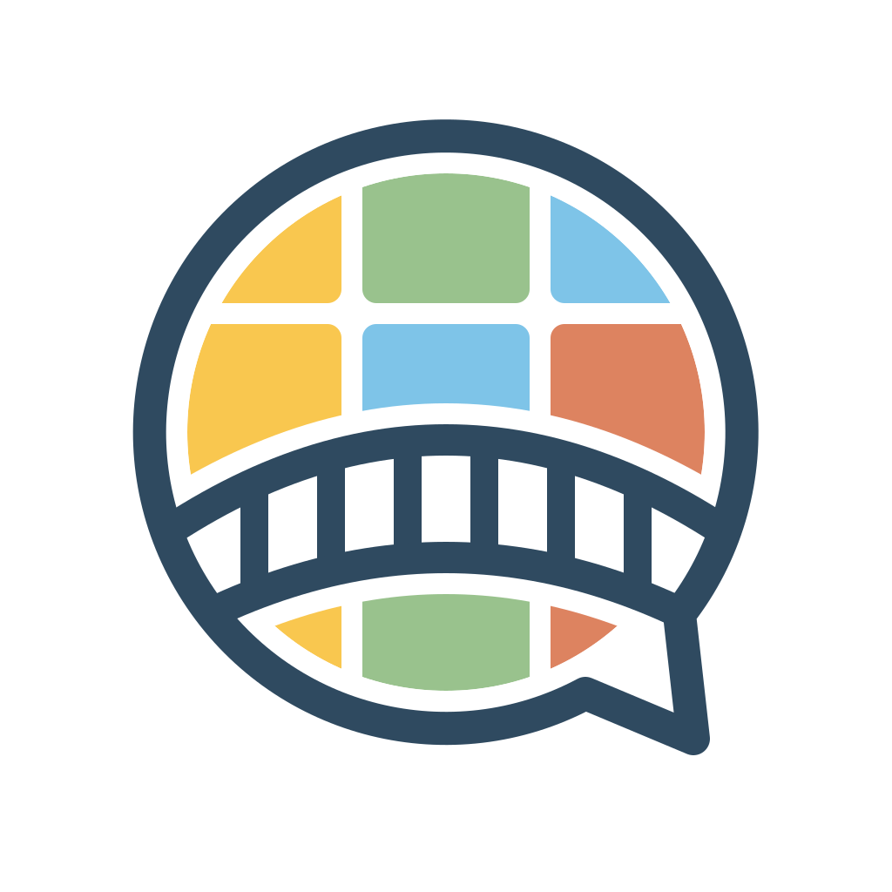
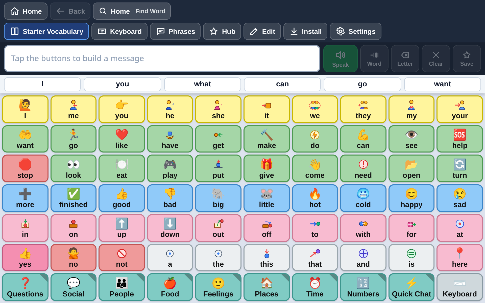
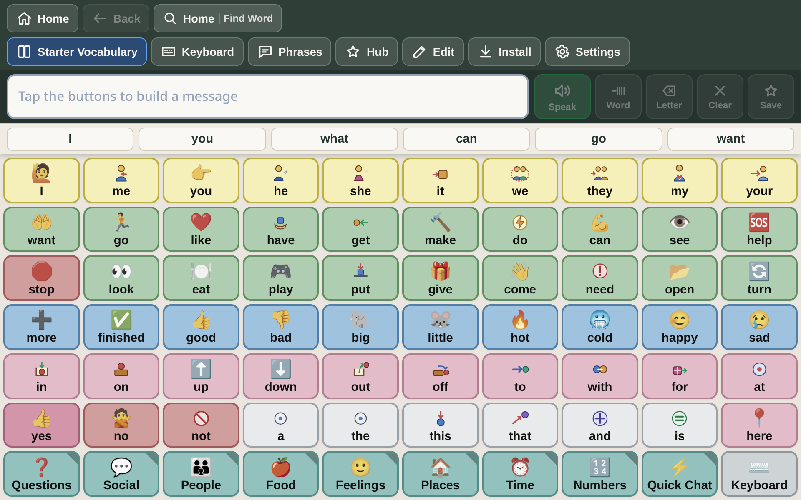
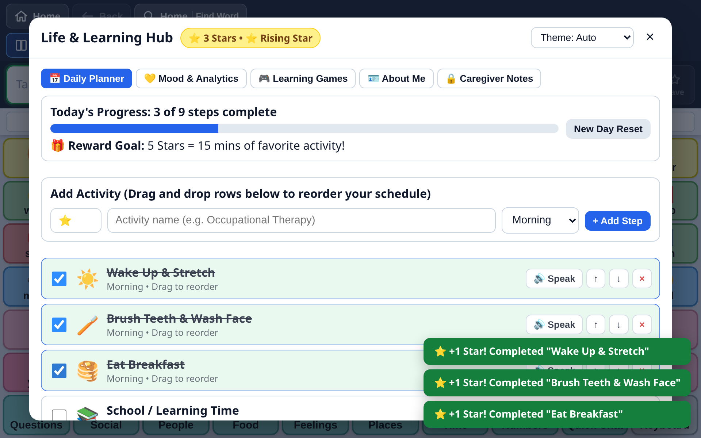
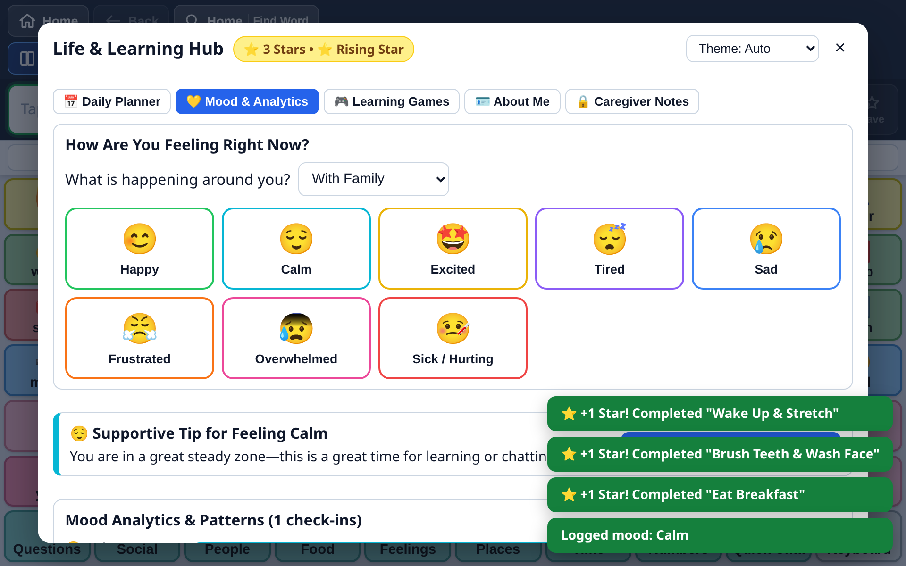
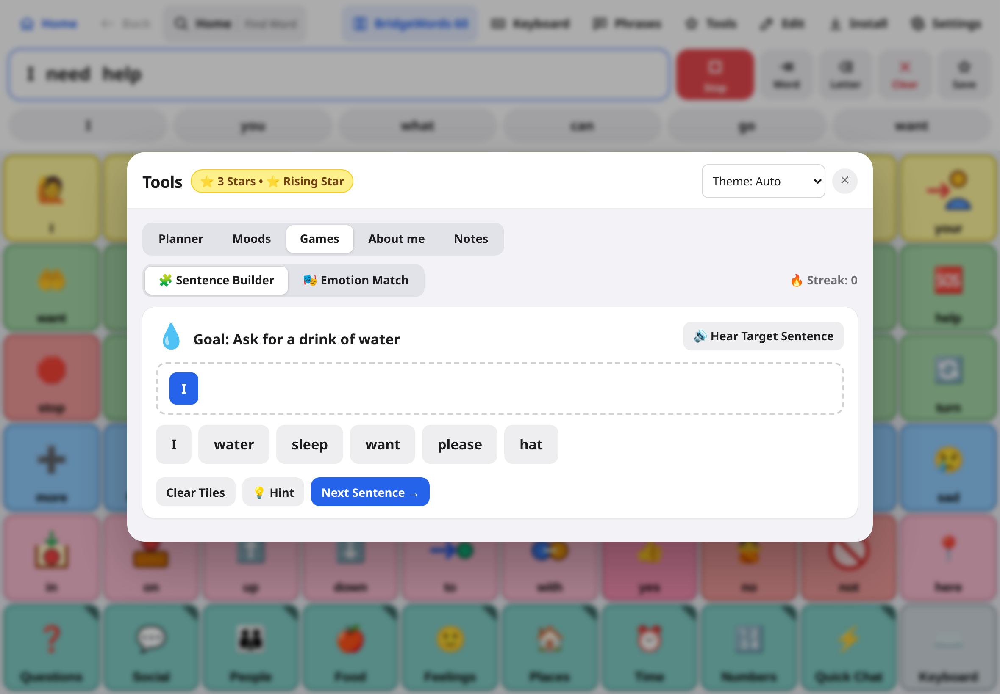
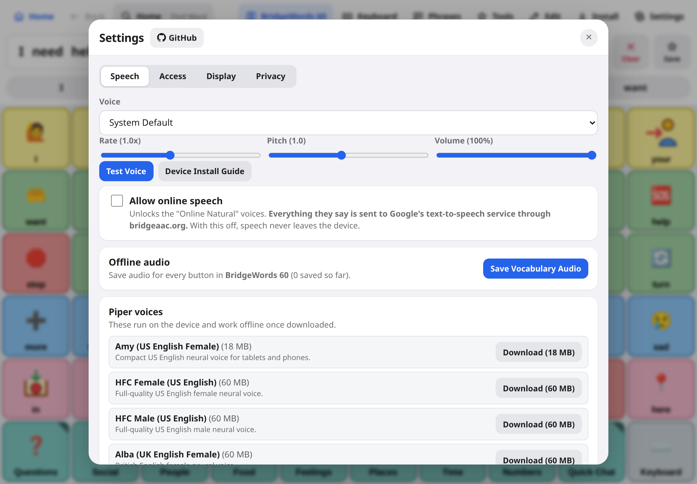
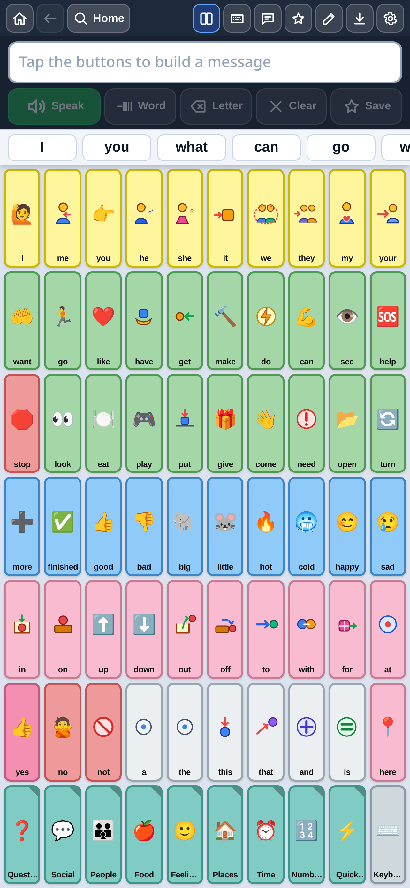

<div align="center">
  
  <h1>BridgeAAC</h1>
  <p><strong>Free, open-source, offline-ready AAC (Augmentative and Alternative Communication) software for everyone.</strong></p>
  <p>
    Compatible with <strong>Open Board Format (<code>.obf</code>, <code>.obz</code>)</strong>,
    <strong>BridgeAAC (<code>.bridge</code>)</strong>, and standard AAC backup formats (<code>.ce</code>, <code>.c4v</code>, <code>.wf</code>).
  </p>
  <p>
    <a href="https://bridgeaac.org"><strong>Website (bridgeaac.org)</strong></a> &bull;
    <a href="https://github.com/BridgeAAC/core/wiki"><strong>Documentation Wiki</strong></a> &bull;
    <a href="#screenshots"><strong>Screenshots</strong></a> &bull;
    <a href="#installation"><strong>Installation</strong></a> &bull;
    <a href="#supported-languages"><strong>10 Languages</strong></a> &bull;
    <a href="#development--cicd"><strong>Development</strong></a>
  </p>
</div>

---

## Screenshots

<div align="center">
  
  <p><em>The BridgeWords 60 board with word suggestions and the message bar. Colors follow word type.</em></p>
</div>

<br />

| Calm theme | Planner |
| :---: | :---: |
|  |  |
| *A low-glare theme with softer colors, for kids who find bright screens hard.* | *A visual schedule with spoken steps and a star reward.* |

| Moods | Games |
| :---: | :---: |
|  |  |
| *Log how you feel, hear a coping phrase, and see your history.* | *Sentence builder and emotion matching games that speak every tile.* |

| Speech settings | On a phone |
| :---: | :---: |
|  |  |
| *Pick a voice, download Piper voices for offline use, and set rate and pitch.* | *The same board on a phone.* |

---

---

## Why I Built BridgeAAC

I’m 15 years old. I built BridgeAAC because my 16-year-old sister has to have an iPad for an AAC device to communicate. An iPad alone costs hundreds of dollars — and that doesn’t even include the AAC app itself, which also costs hundreds of dollars more.

I love my sister, and I wanted every person and family to have access to a real AAC communication board without having to pay hundreds of dollars just to speak. BridgeAAC is **100% free, open-source (MIT License), and works offline** on whatever tablet, phone, Chromebook, or computer a family already has.

---

## Key Features

### 1. Interoperability with `.ce` & Open Board (`.obf` / `.obz`) Formats
- **Client-Side File Import & Export**: Reads and creates `.ce`, `.c4v`, and `.wf` format archives (`*.c4v` SQLite databases, `Images.c4s` symbol libraries, and user audio) directly in the browser using WebAssembly (`sql.js` and `fflate`).
- **Round-Trip Layout Fidelity**: Preserves row/column coordinates, multi-cell spans, BGR colors, button borders, custom user symbols, page navigation stacks, grammar word-ending modifiers (`button_sets` / action `71`), and suffix attachment (`-s`, `-ing`, `-ed`, `-er`, `-est`).
- **Open Board Format (`.obf` / `.obz`)**: Imports and exports single-page `.obf` boards and multi-page `.obz` archives with embedded images and sounds.

### 2. Three-Tier Offline Speech Engine
BridgeAAC is engineered so speech **always works offline**, even on devices without system TTS voices or internet access. By default, speech never leaves the device. Optional *Online Natural* voices, which are off by default, send spoken text to Google's text-to-speech service. See [Privacy & Security](https://github.com/BridgeAAC/core/wiki/Privacy-HIPAA-and-Security).
1. **Built-in Instant Offline Synthesizer (`meSpeak` Web Audio)**: Bundled directly inside the app with zero download required. Includes crisp female, male, UK, and multilingual phoneme tables (`en-US`, `en-GB`, `es`, `fr`, `de`, `pt`, `it`, `zh`, plus phonetic romanization for `ar` and `hi`).
2. **One-Click Vocabulary Audio Cache (`tts_cache`)**: Pre-generates and stores spoken audio clips for every button and grammar variant in the active vocabulary into IndexedDB so board buttons speak instantaneously offline.
3. **Offline Neural Voices (Piper VITS ONNX)**: Optional downloadable neural voice models (`en_US`, `en_GB`, `es_MX`, `es_ES`, `fr_FR`, `de_DE`, `pt_BR`, `it_IT`, `ar_JO`, `zh_CN`) stored in the browser's Origin Private File System (OPFS) alongside the local ONNX Runtime and `espeak-ng` phonemizer WASM so any typed sentence is synthesized on-device with zero network requests.
4. **System Voices & Automatic Watchdog Fallback**: Uses OS `speechSynthesis` voices when available (such as Apple Enhanced/Premium iPad voices) and automatically falls back within milliseconds if a system voice is missing or silent.

### 3. Motor Access, Touch Timing & Switch Scanning
- **Touch Timing Filters**: Configurable **Hold Duration** (`0–1200 ms`), **Ignore Repeat / Debounce** (`0–2000 ms`), **Activate on Release**, and **Pointer Dwell** (`0–2500 ms` with visual progress ring for eye-gaze and head-tracking pointers).
- **Switch Scanning**: Supports **1-Switch Automatic Timer** (`Space` to select) and **2-Switch Step** (`Enter` = Next, `Space` = Select) across **Row-then-Column**, **Column-then-Row**, and **Linear** scan patterns.

### 4. Full On-Device Grid Editor & Word Finder
- **Visual Editing**: Tap any cell in Edit Mode to edit labels, spoken messages, Fitzgerald Key colors, actions, grammar variants, custom uploaded photos, or search **ARASAAC** pictograms (an opt-in online feature that sends search words to api.arasaac.org).
- **60-Step Undo / Redo**: Safely experiment with grid dimensions (`cols × rows`) without losing off-grid buttons.
- **Find Word Pathfinder**: Search for any word in the vocabulary to see the exact step-by-step folder sequence from the Home page.
- **PIN Lock**: Optional PIN for Edit Mode, Vocabularies, and Settings so users don't accidentally exit their board. The PIN is stored as a salted hash. It is an access lock, not encryption.

### 5. Life, Sensory & Learning Hub
- **Color Modes (Light, Dark, Calm & High Contrast)**: Includes a sensory-friendly **Calm Mode** with warm low-glare sage/oatmeal tones and softened pastel button saturation to reduce visual overload.
- **Customizable Phrases & Soundboard**: Express wants, needs, feelings, and quick responses with one-tap color-coded soundboard tiles, plus custom soundboard button creation.
- **Interactive Daily Planner**: Drag-and-drop visual schedule with Morning/Afternoon/Evening routines, spoken task announcements, and gamified Star & Badge rewards.
- **Mood Tracking & Analytics**: Log emotions and environmental triggers, receive immediate supportive coping tips with one-tap spoken requests, and view mood distribution charts.
- **Gamified Learning Games**: Interactive **Sentence Builder** and **Emotion Match** games that speak every tapped tile and reward streaks with stars.
- **"About Me" Communication Passport**: Share likes, dislikes, sensory triggers, allergies/medical needs, calming strategies, and emergency contacts with caregivers, nurses, or teachers — with one-tap speech on every card.
- **Encrypted Caregiver Notes**: Observation log for parents, teachers, and SLPs. With a passcode set, it is encrypted on the device (AES-256-GCM). Includes category filtering and `.txt` report export (plaintext).

---

## Supported Languages

BridgeAAC includes **10 complete offline starter vocabularies** (11 pages each: Home, Quick Chat, Food & Drink, Places, People, Actions, Feelings, Describe, Things, Time, and Colors), localized app menus, offline word prediction dictionaries, localized keyboards, and multilingual symbol resolution:

| Code | Language | Native Name | Direction | Starter Board | Offline Prediction | Piper Neural Model |
| :--- | :--- | :--- | :---: | :---: | :---: | :--- |
| `en` | English | English | LTR | 11 pages | Yes | `en_US-amy-low`, `en_US-hfc_female-medium`, `en_US-hfc_male-medium`, `en_GB-alba-medium` |
| `es` | Spanish | Español | LTR | 11 pages | Yes | `es_MX-ald-medium`, `es_ES-davefx-medium` |
| `fr` | French | Français | LTR | 11 pages | Yes | `fr_FR-siwis-medium` |
| `de` | German | Deutsch | LTR | 11 pages | Yes | `de_DE-thorsten-medium` |
| `pt` | Portuguese | Português | LTR | 11 pages | Yes | `pt_BR-faber-medium` |
| `it` | Italian | Italiano | LTR | 11 pages | Yes | `it_IT-riccardo-x_low` |
| `ar` | Arabic | العربية | **RTL** | 11 pages | Yes | `ar_JO-kareem-medium` |
| `zh` | Chinese (Mandarin) | 中文 (普通话) | LTR | 11 pages | Yes | `zh_CN-huayan-medium` |
| `hi` | Hindi | हिन्दी | LTR | 11 pages | Yes | Built-in phonetic + System TTS |
| `tl` | Tagalog / Filipino | Tagalog | LTR | 11 pages | Yes | Built-in phonetic + System TTS |

---

## Installation

### iPad & iPhone (Safari Web App — No App Store Purchase Required)
1. Open **[https://bridgeaac.org](https://bridgeaac.org)** in **Safari**.
2. Tap the **Share** button in the Safari toolbar and select **Add to Home Screen**.
3. Open **BridgeAAC** from the Home Screen to run full-screen offline.
4. *Optional*: Open **Install** in the top bar and tap **Save Voices Offline** to pre-cache audio for every button on your board.
5. *Optional*: Enable **Guided Access** in `Settings > Accessibility > Guided Access` on iPadOS to lock the iPad to BridgeAAC during daily use.

### Android Tablets & Phones
- **From Chrome**: Open **[https://bridgeaac.org](https://bridgeaac.org)** in Chrome and select **Install app** from the browser menu.
- **Native APK**: Download `BridgeAAC-android.apk` from [GitHub Releases](https://github.com/bridgeaac/core/releases) or build locally with:
  ```bash
  npm run android:init && npm run android:build
  ```

### Windows, macOS & Linux
- **Prebuilt Releases**: Download the installer for your platform (`.exe` NSIS installer / portable executable for Windows, `.dmg` for macOS, `.AppImage` / `.deb` for Linux) from [GitHub Releases](https://github.com/bridgeaac/core/releases).
- **Build Locally**:
  ```bash
  # Windows (.exe)
  npm run desktop:build:win

  # Linux (.AppImage & .deb)
  npm run desktop:build:linux
  ```

---

## Development & CI/CD

```bash
# Install dependencies
npm install

# Start local development server
npm run dev

# Run TypeScript typechecking
npm run typecheck

# Run automated test suite (Vitest)
npm test

# Build optimized offline PWA bundle into dist/
npm run build
```

### Automated GitHub Actions & Cloudflare Pages Workflows
- **`.github/workflows/ci-deploy.yml`**: Runs typechecking, unit tests, and production PWA builds on every push, and supports Cloudflare Pages deployment (`bridgeaac.org`).
- **`.github/workflows/build-apps.yml`**: Builds native desktop installers (Windows `.exe`, Linux `.AppImage`/`.deb`, macOS `.dmg`) and Android `.apk` packages, and automatically publishes/updates the downloadable installers on **GitHub Releases** on every push to `main` as well as on version tags (`v*`).

---

## Immediate Support for Autism Parents & Families

If you are an autism parent, caregiver, special education teacher, or therapist experiencing any bug, crash, or accessibility roadblock affecting a communicator:

- **Direct Family Support Email**: **[support@bridgeaac.org](mailto:support@bridgeaac.org?subject=Urgent%20Family%20Support%20-%20BridgeAAC)**
- **Our Commitment**: We understand that an AAC device is a communicator's voice. We treat issues affecting autistic and non-speaking individuals with top priority and work to fix them immediately.

---

## Legal, Interoperability & Medical Disclaimer

- **Not a Medical Device**: BridgeAAC is an open-source assistive communication application. It is **NOT** a medical device, has not been evaluated or approved by the FDA or any medical authority, and is not a substitute for professional medical, clinical, psychological, or speech-language pathology advice.
- **No Emergency Services / 911**: BridgeAAC cannot place emergency phone calls or contact emergency dispatchers. Caregivers must maintain an independent telephone or emergency device at all times.
- **Trademark & Interoperability Attribution**: WordPower™ is a registered trademark of Inman Innovations, Inc. SymbolStix® is a registered trademark of n2y LLC. References to file extensions (`.ce`, `.c4v`, `.wf`, `.obf`) are for technical interoperability and migration of user-owned backups. BridgeAAC is an independent, non-commercial open-source project and is **not** affiliated with, sponsored by, authorized by, or endorsed by PRC-Saltillo, Inman Innovations, Inc., n2y LLC, or Apple Inc.
- **Limitation of Liability**: Provided **"AS IS"** under the MIT License without warranty of any kind. In no event shall the authors or contributors be liable for any damages, communication disruptions, device malfunctions, or data loss.
- **Full Legal Terms**: See **[DISCLAIMER.md](DISCLAIMER.md)** for complete liability waivers, clinical disclaimers, and intellectual property notices.

---

## License

BridgeAAC is free and open-source software licensed under the **[MIT License](LICENSE)**.
