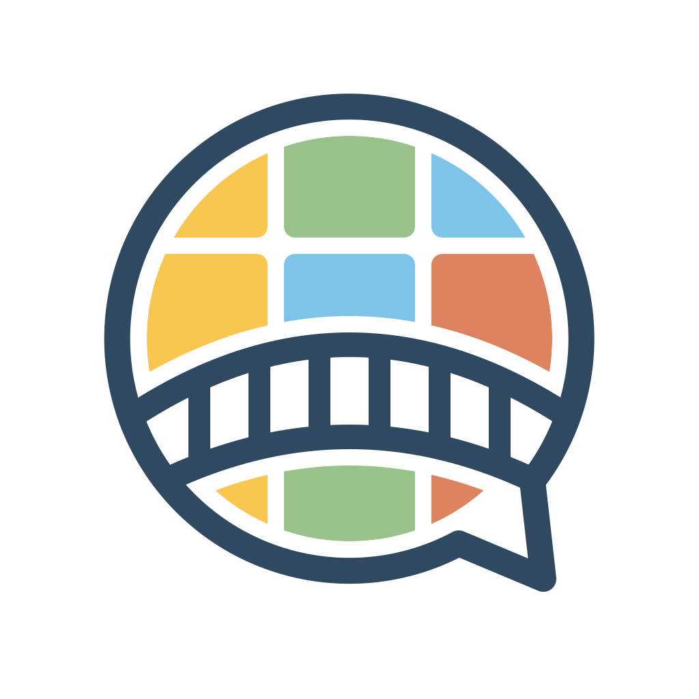
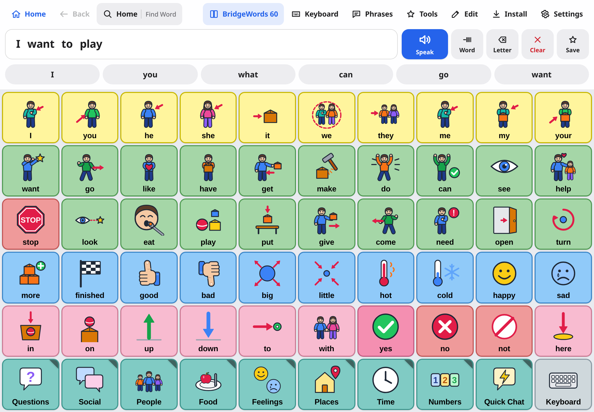
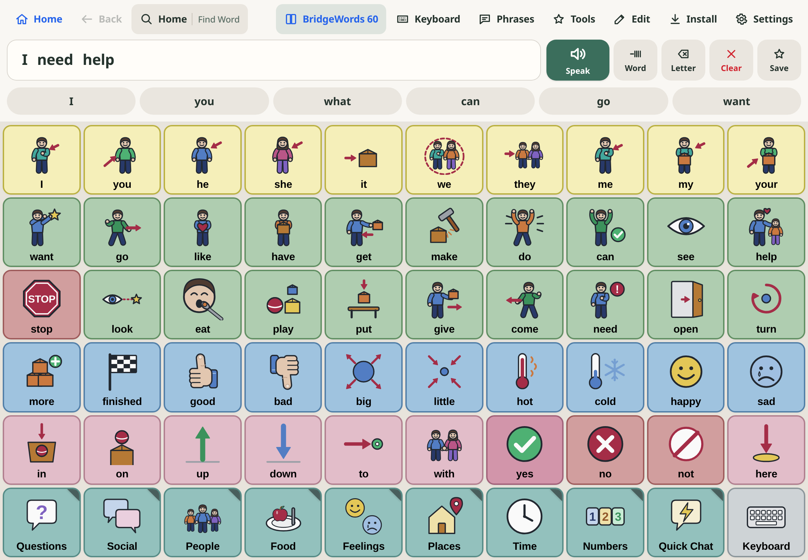
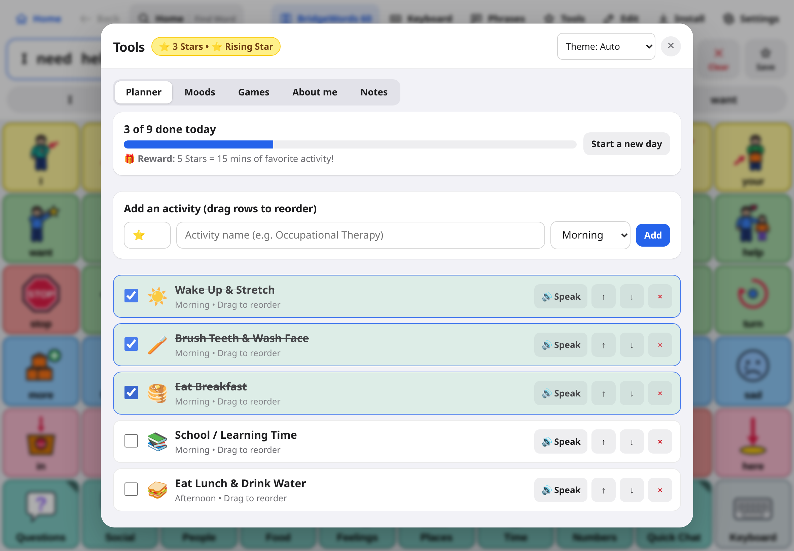
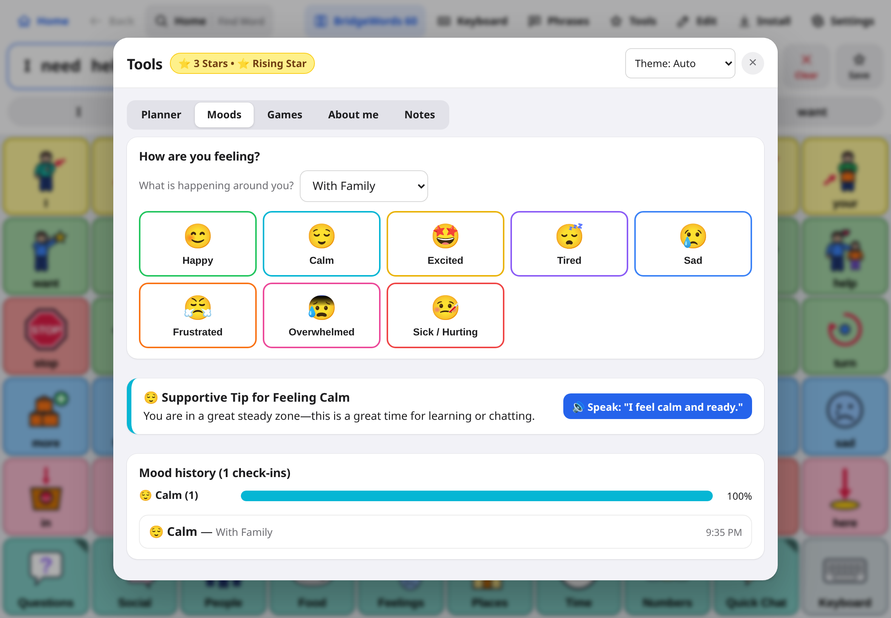
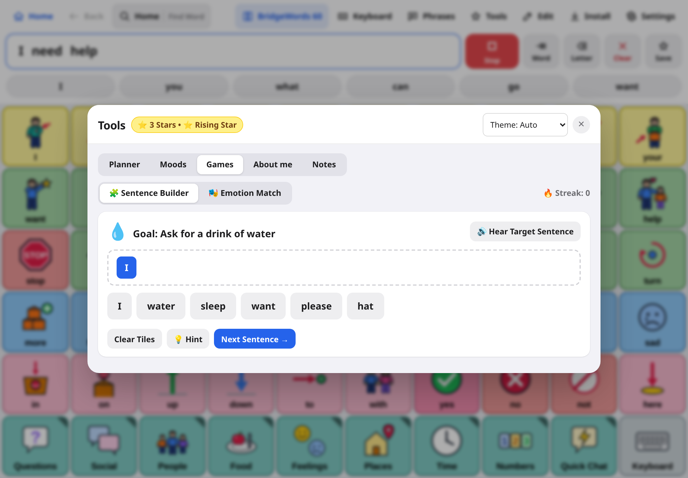
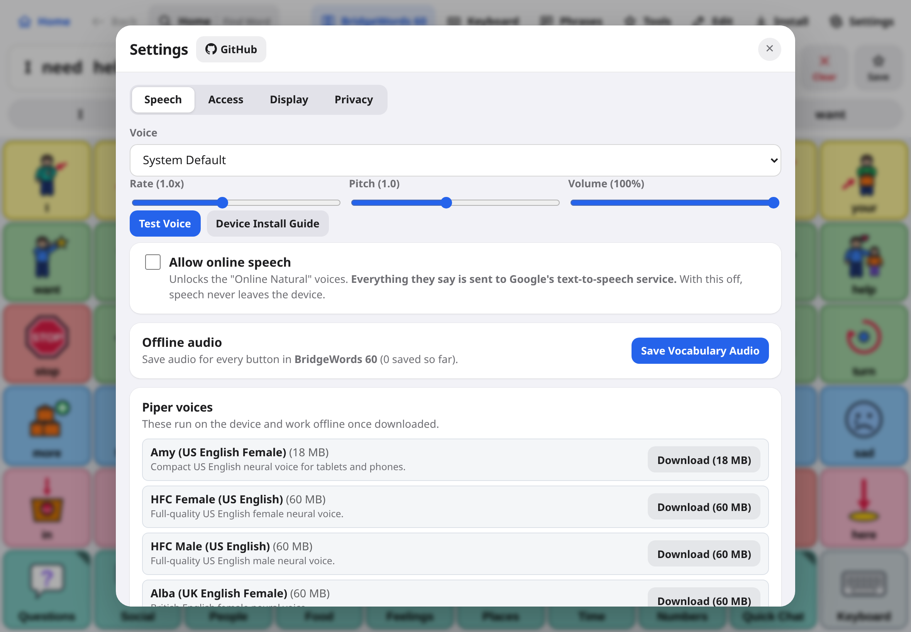
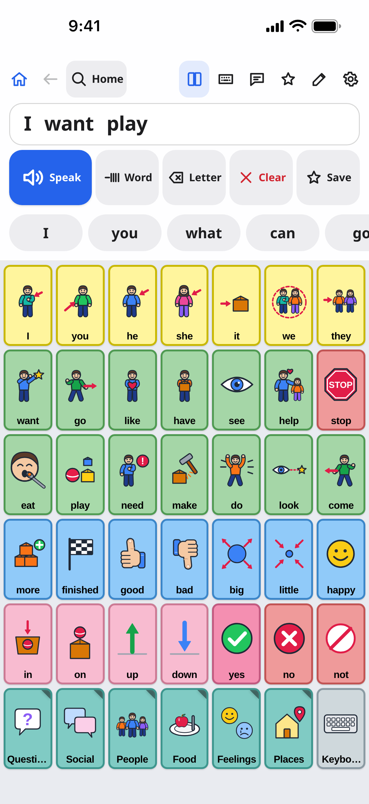

<div align="center">
  
  <h1>BridgeAAC</h1>
  <p><strong>A free, open-source AAC app that works offline.</strong></p>
  <p>
    Opens <code>.obf</code>, <code>.obz</code>, <code>.bridge</code>, <code>.ce</code>, <code>.c4v</code>, and <code>.wf</code> boards. No accounts, no ads, no tracking.
  </p>
  <p>
    <a href="https://bridgeaac.org"><strong>bridgeaac.org</strong></a> &bull;
    <a href="https://github.com/BridgeAAC/core/wiki"><strong>Wiki</strong></a> &bull;
    <a href="#screenshots"><strong>Screenshots</strong></a> &bull;
    <a href="#install"><strong>Install</strong></a> &bull;
    <a href="#languages"><strong>Languages</strong></a> &bull;
    <a href="#developing"><strong>Developing</strong></a> &bull;
    <a href="https://ko-fi.com/kashcotton"><strong>Ko-fi</strong></a>
  </p>
</div>

---

## Why I built this

I'm 15. I built BridgeAAC because my 16-year-old sister uses an iPad as her AAC device to communicate. An iPad alone costs hundreds of dollars, and most AAC apps cost hundreds more on top of that.

I love my sister, and I don't think a family should have to spend hundreds of dollars just so their kid can talk. BridgeAAC is free, open-source (MIT), and runs offline on whatever tablet, phone, Chromebook, or computer a family already has.

---

## Screenshots

<div align="center">
  
  <p><em>BridgeWords 60 with word suggestions and the message bar. Colors follow word type.</em></p>
</div>

<br />

| Calm theme | Planner |
| :---: | :---: |
|  |  |
| *Lower glare and softer colors for kids who find bright screens rough.* | *A visual daily schedule with spoken steps and star rewards.* |

| Moods | Games |
| :---: | :---: |
|  |  |
| *Log how you feel, tap a coping phrase, and check past check-ins.* | *Sentence builder and emotion matching games that speak every tile.* |

| Speech settings | On a phone |
| :---: | :---: |
|  |  |
| *Pick a voice, download Piper voices for offline use, and adjust speed and pitch.* | *The same board on an iPhone.* |

---

## What's in it

### Boards, symbols, and importing old files
- Comes with **BridgeWords** starter boards in 42, 60, 84, and 108 button sizes, plus an **ARASAAC Core 50** board.
- Includes **770+ original built-in symbols** so boards work out of the box without Wi-Fi. You can also upload your own photos or turn on optional ARASAAC symbol search (opt-in; sends search words to `api.arasaac.org`).
- Imports and exports `.ce`, `.c4v`, and `.wf` backups directly on your device using WebAssembly (`sql.js` and `fflate`), keeping grid positions, multi-cell spans, colors, borders, custom images, folder navigation, and grammar word endings (`-s`, `-ing`, `-ed`, `-er`, `-est`).
- Full Open Board Format (`.obf` and `.obz`) import and export, plus `.bridge` backups.

### Offline speech
Speech works without internet, and by default nothing you type or tap leaves the device. Optional *Online Natural* voices are off until you turn them on (they send spoken text to Google's text-to-speech service — see [Privacy & Security](https://github.com/BridgeAAC/core/wiki/Privacy-HIPAA-and-Security)).
- **Built-in synth (`meSpeak`)** works immediately with zero downloads.
- **Downloadable neural voices (Piper VITS ONNX)** run locally on your device once downloaded (`en_US`, `en_GB`, `es_MX`, `es_ES`, `fr_FR`, `de_DE`, `pt_BR`, `it_IT`, `ar_JO`, `zh_CN`).
- **One-click board audio cache** pre-saves spoken clips for every button on your board so taps speak right away.
- **System voices** (like Apple's Enhanced/Premium voices on iPad) work too, with automatic fallback if a system voice goes silent.

### Editing and finding words
- Tap **Edit** to change any button's label, spoken message, color, picture, action, or grammar variants, with 60-step undo/redo.
- **Find Word** shows the exact folder path from Home to any word in your vocabulary.
- Optional **PIN lock** for Edit Mode, Vocabularies, and Settings so nobody accidentally changes their board. The PIN is stored as a salted hash (it's an access lock, not encryption).

### Access, themes, and extra tools
- **Themes:** Light, Dark, High Contrast, and **Calm** (warmer, muted colors for sensory comfort).
- **Motor access:** Hold duration (`0–1200 ms`), ignore repeat / debounce (`0–2000 ms`), activate on release, pointer dwell (`0–2500 ms` with a progress ring for eye-gaze or head tracking), and 1-switch / 2-switch scanning (row-column, column-row, or linear).
- **Daily tools:** A visual daily planner with spoken steps and star rewards, a quick-phrase soundboard, mood check-ins with coping phrases, sentence-builder and emotion-match games, an **About Me** communication passport (allergies, triggers, calming strategies, emergency contacts), and **Caregiver Notes** (encrypted on-device with AES-256-GCM when you set a passcode; `.txt` exports are plaintext).

---

## Languages

BridgeAAC has 10 starter vocabularies (11 pages each: Home, Questions, Social, People, Food & Drink, Feelings & Needs, Places, Time, Numbers, Colors, and Quick Chat), translated menus, offline word prediction, and localized keyboards:

| Code | Language | Native Name | Direction | Offline Prediction | Piper Neural Voices |
| :--- | :--- | :--- | :---: | :---: | :--- |
| `en` | English | English | LTR | Yes | `en_US-amy-low`, `en_US-hfc_female-medium`, `en_US-hfc_male-medium`, `en_GB-alba-medium` |
| `es` | Spanish | Español | LTR | Yes | `es_MX-ald-medium`, `es_ES-davefx-medium` |
| `fr` | French | Français | LTR | Yes | `fr_FR-siwis-medium` |
| `de` | German | Deutsch | LTR | Yes | `de_DE-thorsten-medium` |
| `pt` | Portuguese | Português | LTR | Yes | `pt_BR-faber-medium` |
| `it` | Italian | Italiano | LTR | Yes | `it_IT-riccardo-x_low` |
| `ar` | Arabic | العربية | **RTL** | Yes | `ar_JO-kareem-medium` |
| `zh` | Chinese (Mandarin) | 中文 (普通话) | LTR | Yes | `zh_CN-huayan-medium` |
| `hi` | Hindi | हिन्दी | LTR | Yes | Built-in synth + System TTS |
| `tl` | Tagalog / Filipino | Tagalog | LTR | Yes | Built-in synth + System TTS |

---

## Install

### iPad & iPhone
The App Store version is in the works — in the meantime, you can install it right now for free:
1. Open **[bridgeaac.org](https://bridgeaac.org)** in **Safari**.
2. Tap **Share** and choose **Add to Home Screen**.
3. Open **BridgeAAC** from your Home Screen — it runs full-screen and works offline.
4. *(Optional)* Tap **Install** in the top bar and hit **Save Voices Offline** to cache audio for your board, or turn on **Guided Access** in iPadOS Settings to keep the screen locked to BridgeAAC.

### Android
- **Chrome:** Open **[bridgeaac.org](https://bridgeaac.org)** in Chrome and tap **Install app** from the menu.
- **APK:** Grab `BridgeAAC-android.apk` from [GitHub Releases](https://github.com/BridgeAAC/core/releases), or build it yourself with `npm run android:init && npm run android:build`.

### Windows, macOS & Linux
Download the installer for your OS (`.exe`, `.dmg`, `.AppImage`, or `.deb`) from [GitHub Releases](https://github.com/BridgeAAC/core/releases), or build locally:

```bash
npm run desktop:build:win
npm run desktop:build:mac
npm run desktop:build:linux
```

---

## Developing

```bash
npm install
npm run dev        # local dev server
npm run typecheck  # TypeScript check
npm test           # Vitest suite
npm run build      # production PWA build into dist/
```

GitHub Actions handles CI/CD automatically:
- `.github/workflows/ci-deploy.yml` runs typecheck, tests, and builds/deploys the web app to Cloudflare Pages (`bridgeaac.org`).
- `.github/workflows/build-apps.yml` builds desktop installers and the Android APK and updates GitHub Releases on pushes to `main` and `v*` tags.

---

## Support the project

BridgeAAC is in the works to be published on the Apple App Store and Google Play. To make that happen, I bought a MacBook and paid for both the Apple Developer Program and Google Play developer accounts — and things are getting expensive.

BridgeAAC will always be free, with no paywalls or ads. If it's helped your family and you're able to chip in toward the hardware and developer fees, it really helps: **[ko-fi.com/kashcotton](https://ko-fi.com/kashcotton)**.

---

## Need help?

If you're a parent, caregiver, teacher, or SLP and something is broken or getting in the way of someone communicating, email **[support@bridgeaac.org](mailto:support@bridgeaac.org)** or open an issue. I take bugs that affect actual communicators seriously and try to fix them fast.

---

## Disclaimer & License

- **Not a medical device:** BridgeAAC is open-source software, not an FDA-approved medical device, and not a substitute for professional medical or speech-language pathology advice.
- **No 911 / emergency calling:** BridgeAAC cannot dial emergency services. Always keep a regular phone available.
- **Trademarks:** WordPower™ is a trademark of Inman Innovations, Inc. SymbolStix® is a trademark of n2y LLC. File extensions like `.ce`, `.c4v`, `.wf`, and `.obf` are only mentioned for importing user-owned backups. BridgeAAC is an independent project and is not affiliated with PRC-Saltillo, Inman Innovations, n2y, or Apple.
- **Warranty:** Provided as-is under the **[MIT License](LICENSE)** with no warranty. See **[DISCLAIMER.md](DISCLAIMER.md)** for full details.
