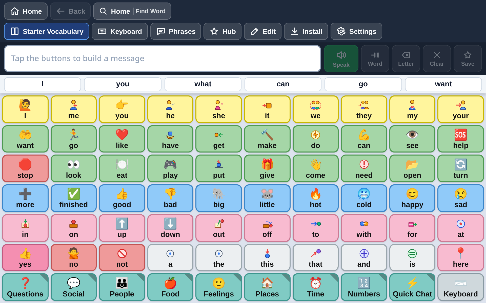

# Getting Started with BridgeAAC

BridgeAAC is designed to run seamlessly across Apple iPad, iPhone, Mac, Android, and Windows devices — with no App Store paywalls, zero subscription fees, and complete offline independence.



> [!NOTE]
> **No App Store Purchase Necessary**: You can use BridgeAAC immediately on an iPad or iPhone by adding it to your Home Screen from Safari. It installs as a dedicated full-screen app with isolated offline storage.

---

## 1. System Requirements

BridgeAAC is lightweight and runs in any modern browser, web app container, or desktop operating system:

| Platform | Minimum Requirement | Recommended Hardware |
| :--- | :--- | :--- |
| **Apple iPad / iPhone** | iOS / iPadOS 15.0 or later | iPad (9th gen or later), iPad Air, iPad Pro |
| **Android** | Android 8.0 (Oreo) or later | Samsung Galaxy Tab A9/S6 Lite, Lenovo Tab M10, Pixel Tablet |
| **Amazon Fire Tablet** | Fire OS 7 (Silk Browser / Sideloaded APK) | Fire HD 10 (2021 or newer) |
| **Chromebook** | ChromeOS 100 or later | Any standard Chromebook with touchscreen |
| **Windows** | Windows 10 (64-bit) or Windows 11 | Any PC, laptop, or Surface Pro tablet |
| **macOS** | macOS 12 (Monterey) or later | Apple Silicon (M1/M2/M3) or Intel Mac |
| **Linux** | Modern x86_64 distribution | Ubuntu 20.04+, Debian 11+, Fedora 36+ |

---

## 2. Installation on Apple iPad & iPhone (Recommended for AAC)

You do **not** need to purchase an expensive app from the App Store. BridgeAAC runs directly as a standalone Progressive Web App (PWA) with complete offline storage.

### Step 1: Add to Home Screen in Safari
1. Open **Safari** on your iPad or iPhone.
2. Navigate to **[https://bridgeaac.org](https://bridgeaac.org)**.
3. Tap the **Share** icon (a square with an upward arrow) in the Safari toolbar.
4. Scroll down and tap **Add to Home Screen**.
5. Tap **Add** in the top-right corner.
6. A **BridgeAAC** icon will appear on your device's home screen.

### Step 2: Open as a Standalone App
1. Tap the **BridgeAAC** icon on your home screen.
2. Notice that Safari’s address bar, tabs, and navigation buttons are hidden. The app runs in dedicated, distraction-free full-screen mode.

### Step 3: Enable Apple Guided Access (Locks the Device to AAC)
Guided Access keeps the iPad locked inside BridgeAAC so the user cannot accidentally exit to YouTube, games, or device settings:
1. Open the iPad’s **Settings** app.
2. Go to **Accessibility** &rarr; **Guided Access**.
3. Toggle **Guided Access** to **ON**.
4. Tap **Passcode Settings** and tap **Set Guided Access Passcode** (choose a 4- or 6-digit passcode only the caregiver or teacher knows).
5. Open **BridgeAAC** from the home screen.
6. **Triple-click the top button** (on iPads without a Home button) or **triple-click the Home button**.
7. In the Guided Access menu, tap **Options** (bottom-left) to disable the volume buttons or sleep button if desired.
8. Tap **Start** in the top-right corner.
9. The iPad is now a dedicated, secure AAC device. To exit at any time, triple-click the top button and enter your passcode.

---

## 3. Installation on Android Tablets & Phones

You have two choices on Android: the high-performance Progressive Web App or the standalone native APK installer.

### Method A: Install via Chrome (PWA)
1. Open **Google Chrome** on your Android device.
2. Navigate to **[https://bridgeaac.org](https://bridgeaac.org)**.
3. Tap the three-dot menu icon in the top right.
4. Tap **Install app** (or **Add to Home screen**).
5. Confirm by tapping **Install**.
6. The app is added to your app drawer and home screen. It functions fully offline without needing network connectivity.

### Method B: Install Native APK
1. Download the latest `BridgeAAC-android.apk` from the [GitHub Releases page](https://github.com/bridgeaac/core/releases).
2. Open the downloaded `.apk` file on your tablet.
3. When prompted, allow installation from your browser or file manager ("Install unknown apps").
4. Tap **Install**.

### Lock with Android App Pinning
1. Open Android **Settings** &rarr; **Security** &rarr; **App pinning** (or "Screen pinning") and enable it.
2. Open BridgeAAC.
3. Swipe up to recent apps, tap the BridgeAAC icon at the top of the card, and select **Pin**.
4. The device will remain locked to BridgeAAC until you swipe up and hold and enter the device PIN.

---

## 4. Installation on Windows, macOS, and Linux

For desktop computers, laptop AAC stations, or classroom interactive whiteboards:

### Windows
1. Download the latest `BridgeAAC-Setup.exe` (NSIS Installer) or portable `.exe` from [GitHub Releases](https://github.com/bridgeaac/core/releases).
2. Run the installer and launch BridgeAAC from your Start menu or desktop shortcut.

### macOS
1. Download the latest `BridgeAAC.dmg` from [GitHub Releases](https://github.com/bridgeaac/core/releases).
2. Open the `.dmg` and drag **BridgeAAC** into your `Applications` folder.
3. Open BridgeAAC from Launchpad or Finder.

### Linux
1. Download `BridgeAAC.AppImage` or `BridgeAAC.deb` from [GitHub Releases](https://github.com/bridgeaac/core/releases).
2. For AppImage:
   ```bash
   chmod +x BridgeAAC.AppImage
   ./BridgeAAC.AppImage
   ```
3. For Debian/Ubuntu:
   ```bash
   sudo dpkg -i BridgeAAC.deb
   ```

---

## 5. First-Time Setup Checklist

Once BridgeAAC is open, complete these four steps for an optimal communication experience:

### 1. Select Your Starter Vocabulary
- Tap the **Vocab** icon (books icon) in the top bar.
- Choose your preferred language (BridgeAAC includes prebuilt starter vocabularies across 10 languages: English, Spanish, French, German, Portuguese, Italian, Arabic, Chinese, Hindi, and Tagalog).
- If you have an existing TouchChat file (`.ce`, `.c4v`, `.wf`) or Open Board file (`.obf`, `.obz`), tap **Import File** to open it immediately.

### 2. Pre-Cache Vocabulary Audio (Instant Speech)
- Tap the **Settings** icon (gear icon) in the top bar.
- Go to the **Speech** tab.
- Scroll to **Offline Vocabulary Audio Cache** and tap **Pre-Cache Active Vocabulary**.
- This generates instant offline audio clips for every single button and grammar variant on your board into IndexedDB.

### 3. (Optional) Download a High-Quality Neural Voice
- In **Settings** &rarr; **Speech**, look at the **Offline Neural Voices (Piper)** section.
- Find your language (e.g., `en_US - Amy (Natural Female)` or `en_US - Ryan (Natural Male)`).
- Tap **Download**. The high-definition neural voice model is stored directly in your browser's private offline storage.

### 4. Set a Caregiver PIN Lock
- In **Settings** &rarr; **System**, locate **Security & PIN Lock**.
- Enter a 4-digit PIN (e.g., `1234`).
- Toggle **Protect Edit Mode** and **Protect Settings**.
- Now the communicator cannot accidentally delete buttons or alter configurations during daily use.
