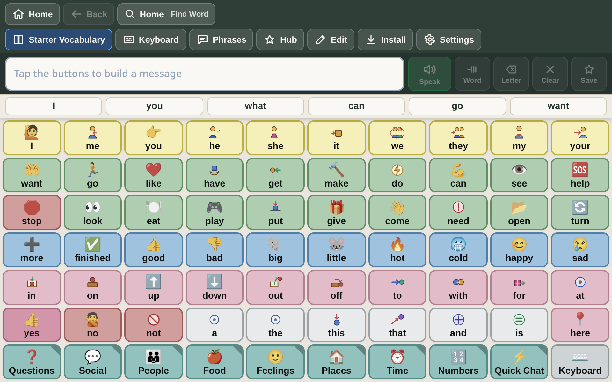

# Grid Editor & Customization Guide

BridgeAAC includes an intuitive on-device grid editor. Therapists, educators, and parents can customize every button, add personal family photos, change vocabulary grids, search open-source ARASAAC symbols, and manage page hierarchies directly on the device.



> [!NOTE]
> **Safe Visual Editing**: Every change is saved automatically to local IndexedDB with continuous **60-step Undo/Redo history**. You can safely experiment with layouts without risking lost work.

---

## 1. Entering Edit Mode

1. Tap the **Edit** icon (pencil icon) in the top toolbar.
2. If **PIN Protection** is enabled in Settings, enter your 4-digit caregiver PIN.
3. The interface will switch to Edit Mode:
   - Cells display editable outlines and dashed drop targets.
   - The top toolbar displays **Done Editing**, **Undo**, **Redo**, **Page Settings**, and **New Page**.

---

## 2. Editing a Button

Tap any cell on the board to open the **Button Editor Modal**:

### Label & Spoken Message
- **Button Label**: The text displayed visually on the button face (e.g., `bathroom`).
- **Spoken Vocalization**: The actual phrase spoken by the text-to-speech engine when the button is tapped (e.g., `I need to use the restroom, please.`). If left blank, BridgeAAC speaks the button label.

### Visual Appearance & Colors
BridgeAAC supports standard **Fitzgerald Key** color-coding conventions used across speech pathology:

| Category | Recommended Color | Fitzgerald Key Significance |
| :--- | :---: | :--- |
| **People / Pronouns** | Yellow (`#FEF08A`) | *I, you, he, she, mom, teacher* |
| **Verbs / Actions** | Green (`#BBF7D0`) | *want, go, eat, play, help, stop* |
| **Nouns / Objects** | Orange (`#FED7AA`) | *water, apple, ball, iPad, book* |
| **Descriptors / Feelings** | Blue (`#BFDBFE`) | *happy, sad, big, cold, more* |
| **Social / Prepositions** | Pink / Magenta (`#FBCFE8` / `#E9D5FF`) | *hello, goodbye, yes, no, thank you* |
| **Miscellaneous / Grammar** | White / Slate (`#FFFFFF` / `#E2E8F0`) | Articles, conjunctions, punctuation |

You can also customize the **Border Color**, **Text Color**, and **Border Radius** (squared vs rounded pill).

### Multi-Cell Spanning
Buttons can span multiple grid cells:
- **Columns (Width)**: Set from 1 to 4 columns.
- **Rows (Height)**: Set from 1 to 4 rows.
- *Clinical application*: Make high-priority communication buttons (e.g., `HELP`, `STOP`, `BATHROOM`) twice as large as standard vocabulary tiles for quick motor access.

---

## 3. Adding Symbols & Custom Photography

BridgeAAC provides three methods for adding visuals to any button:

### Method 1: ARASAAC Open-Source Symbol Search
1. In the Button Editor, tap **Search Symbols**.
2. Type any keyword (e.g., `drink`, `swing`, `school`, `dog`).
3. Select from over 10,000 standardized, high-contrast ARASAAC pictograms.
4. The symbol is saved locally in IndexedDB and works completely offline.

### Method 2: Custom Photo Upload
For personal nouns (family members, pets, specific toys, classroom aides):
1. In the Button Editor, tap **Upload Image** or **Camera**.
2. Select a photo from your device's photo gallery or take a new picture using the device camera.
3. BridgeAAC automatically scales and optimizes the image to keep vocabulary file sizes compact.

### Method 3: Emoji Picker
1. In the Button Editor, tap **Emoji**.
2. Pick any standard Unicode emoji for instant, colorful representation.

---

## 4. Configuring Button Actions

Every button can execute one or multiple actions in sequence:

| Action Type | Behavior | Example Use Case |
| :--- | :--- | :--- |
| **Insert Text** | Appends the word to the message bar with automatic spacing. | Core words (`I`, `want`, `go`) |
| **Speak Vocalization** | Immediately speaks the word aloud. | Quick soundboard tiles, alarms |
| **Navigate to Page** | Opens another folder page in the vocabulary. | Tapping `Food` opens the Food & Drink page |
| **Back** | Returns to the previous page in the navigation stack. | `Back` button on sub-pages |
| **Home** | Returns directly to the root Home communication page. | `Home` button |
| **Clear** | Erases the entire message bar. | `Clear` button |
| **Backspace** | Deletes the last word or character from the message bar. | Editing typed sentences |
| **Grammar Inflection** | Modifies the preceding word with a grammatical ending (`-s`, `-ing`, `-ed`). | Verb conjugation |

---

## 5. Managing Pages & Grid Dimensions

Tap **Page Settings** while in Edit Mode to manage grid structure:

- **Grid Dimensions (`Cols x Rows`)**: Set grid dimensions from `1x1` up to `12x12`.
  - Common therapeutic sizes: `3x3` (9 buttons for emerging communicators), `4x4` (16 buttons), `6x6` (36 buttons), `8x10` (80 buttons for robust vocabulary).
  - **Grid Resizing Protection**: If you shrink a grid from 6x6 to 4x4, off-grid buttons are **not lost**. They are preserved in memory and reappear if the grid is restored.
- **New Page**: Create a new blank page or duplicate an existing template.
- **Set as Home**: Designate any page as the initial root landing board.

---

## 6. Undo, Redo & Safety History

Accidents happen during editing. BridgeAAC records a continuous **60-step Undo / Redo history**:
- Tap **Undo** (or press `Ctrl+Z` / `Cmd+Z`) to reverse any accidental deletion, color change, or move.
- Tap **Redo** (or press `Ctrl+Y` / `Cmd+Shift+Z`) to restore changes.
- All modifications are committed to local IndexedDB automatically.

---

## 7. The Word Finder (Pathfinder) Tool

In large vocabularies with hundreds of words spread across sub-folders, it can be challenging for communicators, parents, or teachers to locate specific vocabulary words.

BridgeAAC includes an intelligent **Word Finder**:
1. Tap the **Search / Pathfinder** icon (magnifying glass) in the top bar.
2. Type the word you are looking for (e.g., `banana`).
3. BridgeAAC shows the exact visual navigation path from the Home page:
   ```
   [Home] ──> [Food & Drink] ──> [Fruits] ──> [banana (Row 2, Col 3)]
   ```
4. Tap **Guide Me**: BridgeAAC takes you to the Home page and highlights the next folder button with a pulsing golden ring, guiding the user step-by-step through the motor pathway to reach the target word.
