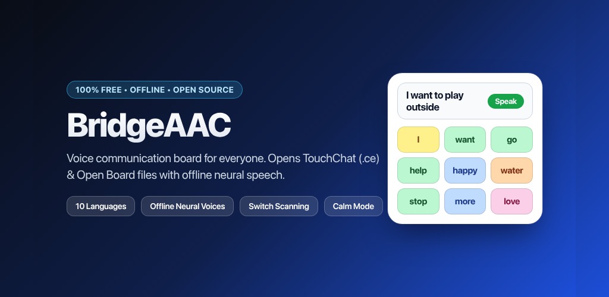
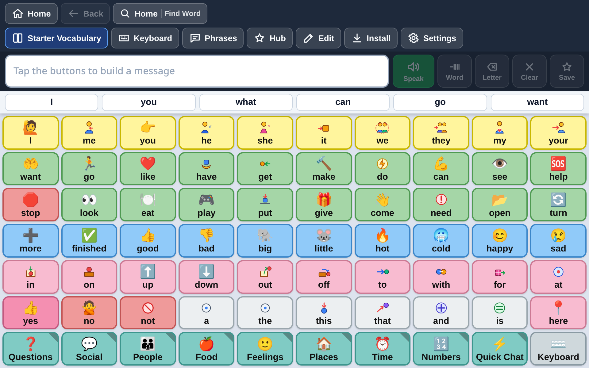
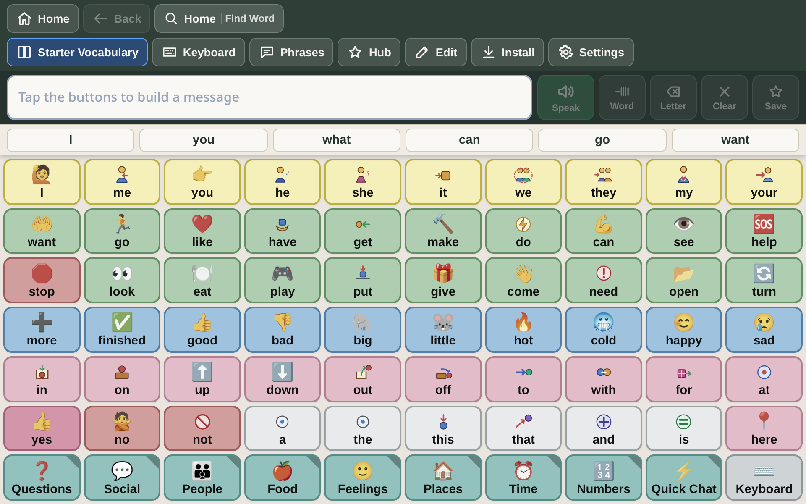
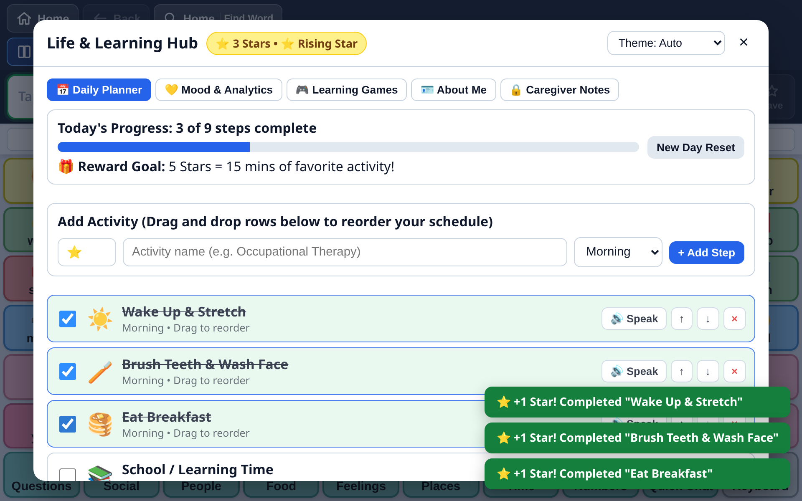
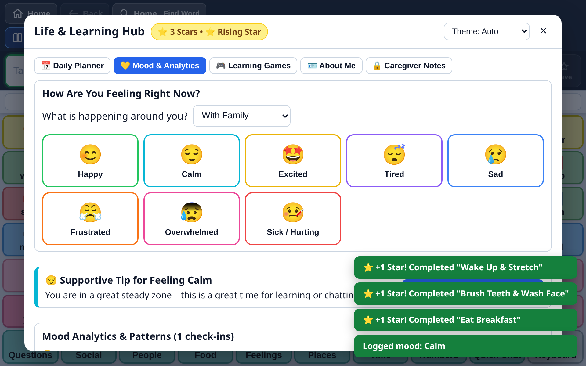
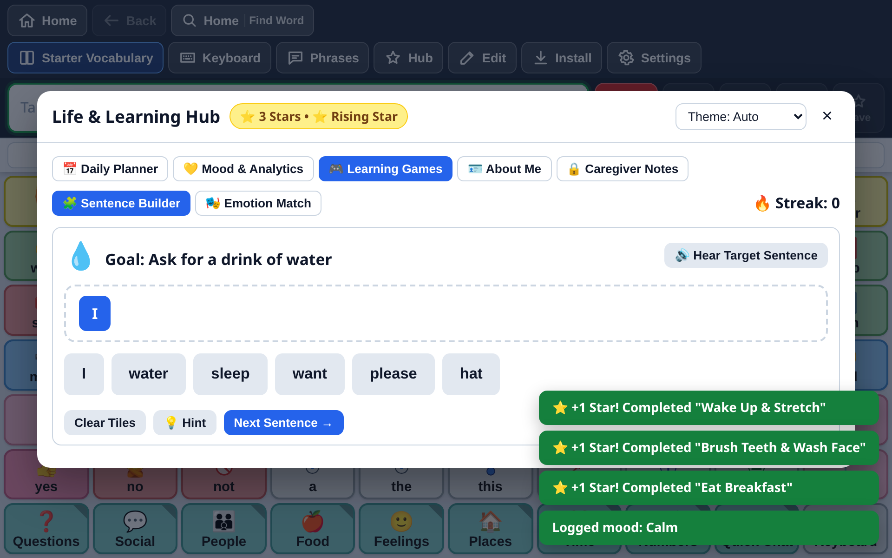
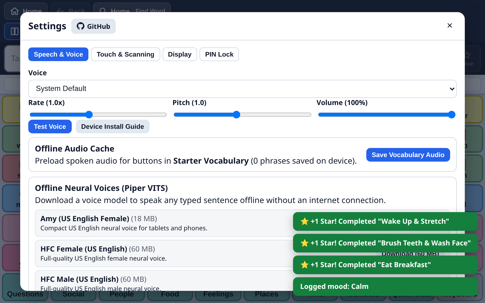

# BridgeAAC

### Augmentative & Alternative Communication for Everyone.



> [!IMPORTANT]
> **A Personal Mission**: Built by a 15-year-old developer for his 16-year-old sister who relies on an iPad for an AAC device to speak. Every individual deserves an autonomous, dignified voice without having to pay thousands of dollars for proprietary hardware, software licenses, or locked ecosystems. 
>
> **100% Free** &bull; **Open Source (MIT)** &bull; **Completely Offline** &bull; **Zero Subscriptions or Tracking**

---

## At a Glance

BridgeAAC provides a modern, touch-first communication system engineered to run on any device a family or school already owns — whether that is an iPad, an Android tablet, a Chromebook, or a PC.

```
┌─────────────────────────────────────────────────────────────────────────────────┐
│  Universal File Support      Offline Neural Speech        Accessible Design     │
│  TouchChat (.ce, .c4v, .wf)  Piper ONNX on-device models  Calm Sensory Mode     │
│  Open Board (.obf, .obz)     meSpeak instant Web Audio    Switch Scanning       │
│  BridgeAAC native (.bridge)  One-click vocab audio cache  Pointer Dwell (Gaze)  │
└─────────────────────────────────────────────────────────────────────────────────┘
```

---

## Visual Tour

| Communication Board | Calm Sensory Mode |
| :---: | :---: |
|  |  |
| *High-contrast, Fitzgerald Key color-coded communication board with intelligent predictive word suggestions.* | *Soft pastel sensory mode designed to eliminate glare and prevent visual fatigue or overload.* |

| Daily Visual Planner | Mood Tracking & Analytics |
| :---: | :---: |
|  |  |
| *Drag-and-drop routines with spoken task guidance, star rewards, and visual milestone goals.* | *Emotion check-ins with immediate coping cards, single-tap requests, and caregiver trend charts.* |

| Gamified Skill Learning | Speech & Offline Customization |
| :---: | :---: |
|  |  |
| *Sentence Builder and Emotion Match games designed to build syntax and social-emotional understanding.* | *Integrated voice manager with downloadable neural voices, pitch/rate controls, and pre-caching.* |

---

## Documentation Index

Explore the complete system documentation:

| Guide | Core Content | Audience |
| :--- | :--- | :--- |
| **[Getting Started & Installation](Getting-Started)** | Step-by-step setup on iPad (Safari PWA + Guided Access), Android, Windows, macOS, and Linux. | All Users, Families |
| **[File Interoperability & Migration](TouchChat-and-Open-Board-Migration)** | Importing `.ce`, `.c4v`, `.wf`, `.obf`, and `.obz` files with full round-trip layout and symbol fidelity. | SLPs, Therapists, Parents |
| **[Offline Speech & Neural Voices](Speech-and-Offline-Audio)** | The four-tier speech engine, Piper neural ONNX models, audio caching, and pronunciation overrides. | All Users, Caregivers |
| **[Motor Access & Switch Scanning](Motor-Access-and-Switch-Scanning)** | Touch timing filters (hold/repeat debounce), pointer dwell for eye-gaze, and 1/2-switch scanning. | OTs, Assistive Tech Specialists |
| **[Grid Editor & Customization](Grid-Editor-and-Customization)** | Visual button editor, ARASAAC symbol search, personal photo uploads, page creation, and Word Finder. | SLPs, Teachers, Parents |
| **[Life & Learning Hub](Life-and-Learning-Hub)** | Daily Planner, Mood Tracker, Sentence Builder & Emotion Match games, "About Me" passport, and Notes. | Caregivers, Teachers, Users |
| **[Caregiver & Classroom Guide](Caregiver-and-Classroom-Guide)** | Practical AAC modeling (Aided Language Stimulation), Guided Access locking, PIN protection, and backups. | Parents, Teachers, Aides |
| **[Privacy, HIPAA & Security](Privacy-HIPAA-and-Security)** | Zero-telemetry architecture, local-only ePHI isolation, sandboxing, and clinical HIPAA compliance. | SLPs, Clinics, Families |
| **[Languages & Localization](Languages-and-Localization)** | Breakdown of all 10 supported languages, RTL Arabic engine, multilingual keyboards, and prediction. | International Users, SLPs |
| **[Technical Architecture & Build](Technical-Architecture-and-Deployment)** | Deep technical look at IndexedDB, OPFS, SQLite WASM, Piper ONNX, Electron, Swift, and CI/CD. | Developers, Contributors |
| **[Troubleshooting & FAQ](Troubleshooting-and-FAQ)** | Solutions for audio silence, offline storage limits, TouchChat file imports, and switch setups. | All Users |
| **[Legal & Medical Disclaimer](Legal-and-Medical-Disclaimer)** | Critical medical disclaimers, limitation of liability, and third-party trademark notices. | All Users |

---

## Immediate Support for Autism Parents & Families

If you are an autism parent, caregiver, special education teacher, or therapist and run into any bug, crash, display issue, or accessibility roadblock affecting a communicator:

> [!IMPORTANT]
> **Priority Family Support**: Contact us directly at **[support@bridgeaac.org](mailto:support@bridgeaac.org?subject=Urgent%20Family%20Support%20-%20BridgeAAC)**. We prioritize bug fixes and accommodations for non-speaking individuals and families immediately.

---

## Platform Support

> [!TIP]
> On iPad and iPhone, BridgeAAC runs as a standalone full-screen Progressive Web App via Safari (`Add to Home Screen`). It requires zero App Store purchases and remains completely functional offline.

| Device | Operating System | Installation Method | Offline Storage | Guided Access / Lock |
| :--- | :--- | :--- | :---: | :---: |
| **Apple iPad / iPad mini / iPad Pro** | iPadOS 15.0+ | Safari PWA (`Add to Home Screen`) | OPFS & IndexedDB | Apple Guided Access |
| **Apple iPhone** | iOS 15.0+ | Safari PWA (`Add to Home Screen`) | OPFS & IndexedDB | Apple Guided Access |
| **Android Tablet / Phone** | Android 8.0+ | Chrome PWA or Native APK | IndexedDB & Cache | Android App Pinning |
| **Chromebook** | ChromeOS 100+ | Chrome PWA (`Install app`) | IndexedDB & Cache | Kiosk Mode |
| **Windows PC / Surface** | Windows 10/11 | Desktop Installer (`.exe`) | Local Filesystem | Windows Assigned Access |
| **macOS** | macOS 12+ | Desktop App (`.dmg`) / Swift | Local Filesystem | Native App Sandbox |
| **Linux** | Modern x86_64 | AppImage / Debian package | Local Filesystem | System Window Lock |

---

## Repository & Open-Source Community

BridgeAAC is developed openly under the MIT License by the community at [**bridgeaac/core**](https://github.com/bridgeaac/core).

- **Core Codebase**: [github.com/bridgeaac/core](https://github.com/bridgeaac/core)
- **Official Web App**: [bridgeaac.org](https://bridgeaac.org)
- **Releases & Installers**: [github.com/bridgeaac/core/releases](https://github.com/bridgeaac/core/releases)
