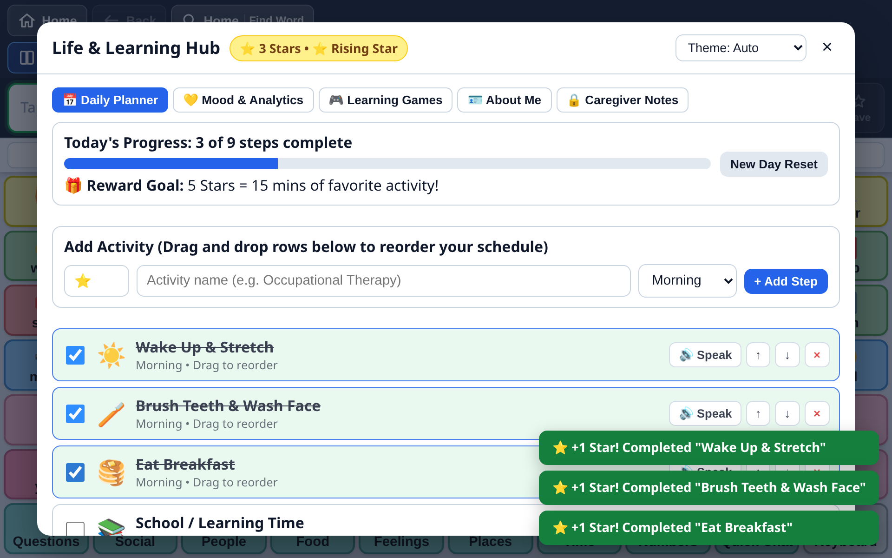
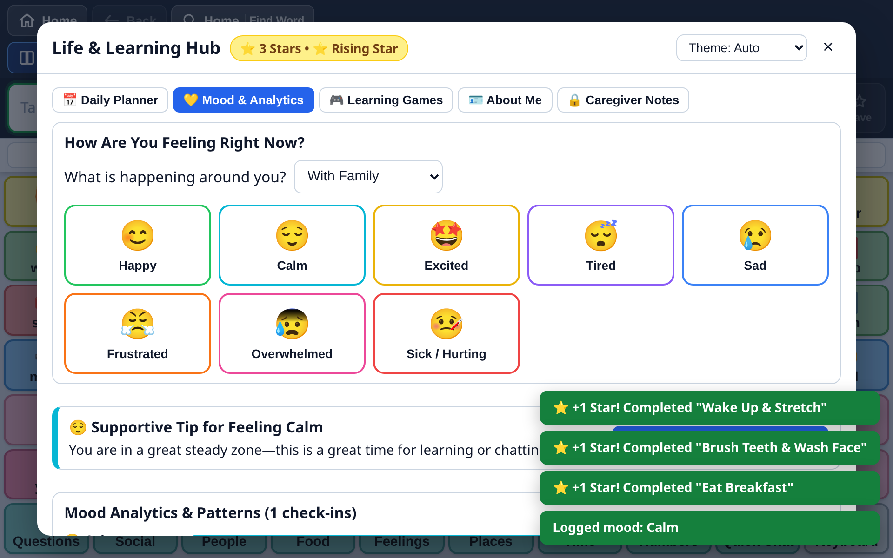
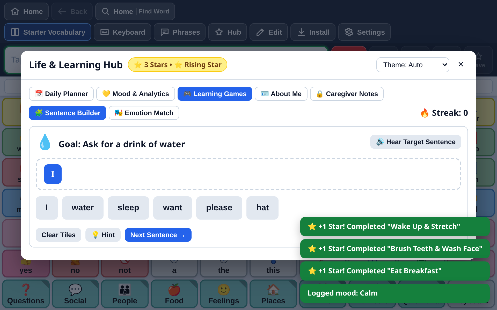

# Life & Learning Hub Guide

Communication is more than pressing buttons on a grid. AAC users need tools to organize their day, regulate their emotions, practice language skills, share personal medical preferences, and express urgent wants and needs without navigating through multi-level folders.

The **Life & Learning Hub** (accessible via the **Hub** star icon in the top toolbar) brings seven therapeutic tools directly into BridgeAAC.

> [!TIP]
> **Sensory Regulation**: When a communicator is showing signs of anxiety, sensory overload, or fatigue, switch to **Calm Mode** in the Hub header. The warm oatmeal palette and softened pastels reduce visual stimulation instantly.

---

## 1. Sensory Color Modes & Calm Mode

AAC users on the autism spectrum or with cortical visual impairments often experience sensory fatigue or visual overload from bright white backgrounds and saturated colors.

BridgeAAC provides four distinct display themes (toggle in **Settings** &rarr; **Display** or in the Hub):

| Theme | Visual Profile | Clinical Application |
| :--- | :--- | :--- |
| **Light Mode** | Crisp white backgrounds, sharp borders, high legibility. | Well-lit classrooms, daytime communication. |
| **Dark Mode** | Deep charcoal/slate backgrounds, glowing tile accents. | Low-light environments, reduces eye strain. |
| **Calm Mode** | Warm low-glare oatmeal background (`#f4f1ea`), softened pastel tiles (soft sage green, muted yellow, pastel sky blue), reduced contrast borders. | Sensory-sensitive communicators, meltdowns, visual overload. |
| **High Contrast** | Pure black background (`#000000`), vibrant neon yellow and cyan borders, bold typography. | Cortical Visual Impairment (CVI), low vision. |

---

## 2. Customizable Phrases & Soundboard

The Soundboard provides instant, single-tap vocalizations organized by urgent communicative functions. Unlike the main vocabulary grid, soundboard phrases speak immediately aloud upon touch:

### Categories
- **Wants**: *I want water*, *I want to play*, *More please*, *Can we listen to music?*
- **Needs**: *I need the bathroom*, *I need help*, *I need a quiet break*, *Something hurts*, *Please stop*, *All done*.
- **Feelings**: *I feel happy*, *I feel calm*, *I feel sad*, *I feel frustrated*, *I feel overwhelmed*.
- **Quick Chat**: *Yes*, *No thank you*, *Wait a moment*, *Thank you*, *I love you*.

### Creating Custom Soundboard Phrases
1. In the Hub, open the **Soundboard** tab.
2. Tap **Add Custom Phrase**.
3. Enter the display label, spoken phrase, emoji, and category.
4. Tap **Save**. Your custom phrase appears at the top of the category list.

---

## 3. Interactive Daily Planner & Gamified Rewards

Visual schedules reduce anxiety and ease transitions for autistic individuals and children with executive functioning challenges.

### Key Features
- **Visual Routine Blocks**: Organize daily tasks by **Morning**, **Afternoon**, and **Evening** periods.
- **Drag-and-Drop Reordering**: Long-press and drag any task tile to re-order the schedule when routines change.
- **Spoken Task Prompts**: Tapping a task tile speaks the task aloud (e.g., *"Put on shoes and backpack"*).
- **Gamified Star Counter**: Tapping the checkmark marks the task complete, plays a positive audio chime, speaks a congratulatory message, and awards **+1 Star** to the user's permanent Star Bank.
- **Custom Reward Goals**: Caregivers can set a motivational milestone (e.g., *"5 Stars = 15 minutes of playground time"*).
- **Daily Reset**: Tap **Reset Schedule for Tomorrow** to uncheck all tasks for the next day without retyping routines.

---

## 4. Mood Tracking & Coping Analytics

Emotional regulation is foundational to effective communication. The Mood Tracker lets users self-report how they feel and receive immediate, actionable coping strategies.

### Logging an Emotion
1. In the Hub, open the **Mood** tab.
2. The user taps their current emotional state: **Happy**, **Calm**, **Sad**, **Frustrated**, **Overwhelmed**, or **Tired**.
3. Select an optional context trigger (*With Family*, *At School*, *Loud Noise*, *Hungry / Thirsty*, *Physical Pain*).
4. BridgeAAC announces the feeling aloud (e.g., *"I feel overwhelmed right now. Please give me some space."*).

### Instant Supportive Coping Cards
Whenever an emotion is selected, BridgeAAC displays a supportive coping recommendation with single-tap spoken requests:
- *For "Frustrated"*: Suggests taking 3 deep breaths, drinking water, or tapping the one-touch button: *"I need a 5-minute break."*
- *For "Overwhelmed"*: Suggests noise-canceling headphones, dimming lights, or tapping: *"Please turn down the volume."*

### Caregiver Mood Analytics
Scroll down in the Mood tab to view:
- **Longitudinal Trend Chart**: Visual breakdown of logged emotions over the last 30 days.
- **Trigger Patterns**: Highlights which environments correlate with dysregulation (e.g., *75% of "Frustrated" logs occurred during "Transition Time"*).

---

## 5. Gamified Learning Games

BridgeAAC includes two research-backed learning games designed to build AAC literacy and emotional intelligence.

### Game 1: Sentence Builder
- **Goal**: Practice sentence grammar and core word syntax.
- **How it works**: The app displays a target idea (e.g., *"I want to play outside"*). A pool of scrambled word tiles (including distractors) is presented below.
- The user taps tiles in the correct grammatical order. Each tapped word is spoken aloud.
- When the sentence is completed correctly, the full phrase is announced with celebratory applause, and **+2 Stars** are awarded to the Star Bank.

### Game 2: Emotion Match
- **Goal**: Develop social-emotional learning and facial cue recognition.
- **How it works**: The app presents a short scenario (e.g., *"Sam's ice cream fell on the ground."*).
- The user selects the emotion that matches the scenario (*Sad*).
- A correct match explains why that feeling occurs, speaks an empathetic response, and awards **+2 Stars**.

---

## 6. "About Me" Communication Passport

When AAC users visit a new doctor, attend a substitute teacher's classroom, or interact with first responders, they need a fast way to communicate critical personal information.

The **About Me** page organizes vital communication information into accessible cards with one-tap speech:

- **Identity**: Full Name, Age, Preferred Pronouns, Photo.
- **Communication Style**: How the person communicates (e.g., *"I understand what you say. I use BridgeAAC to answer. Please give me 5 seconds to type."*).
- **Things I Love**: Special interests, favorite rewards, favorite conversation topics.
- **Things I Dislike**: Sensitivities, fears, foods to avoid.
- **Allergies & Medical Notes**: Critical medical warnings, dietary restrictions.
- **Calming Strategies**: What to do if the person is upset (e.g., *"Give me my weighted blanket and do not force eye contact"*).
- **Emergency Contacts**: Names and phone numbers of parents or primary caregivers.

Tap **Speak My Introduction** to have BridgeAAC read the complete profile aloud.

---

## 7. Passcode-Protected Caregiver Notes

Therapists, special educators, and parents often need a private observation log to track communication milestones, emerging vocabulary, and behavioral antecedents.

- **4-Digit Passcode Protection**: The Notes tab is locked behind a private passcode separate from the AAC communicator.
- **Observation Entries**: Notes can be categorized as *Clinical*, *Milestone*, *Sensory*, or *General*.
- **Export Reports**: Tap **Export Notes** to download a formatted text summary ready for IEP meetings or insurance progress reports.
