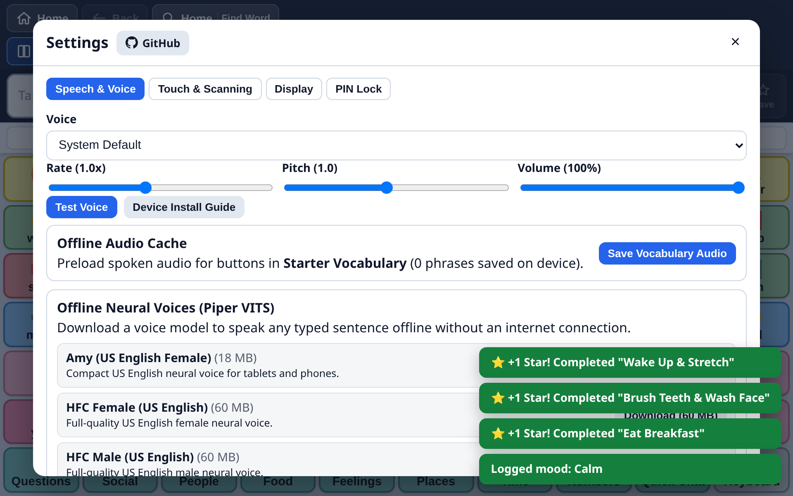

# Offline Speech & Neural Voices

A communication device that cannot speak is useless. BridgeAAC is engineered with a **four-layer resilient speech architecture** designed to guarantee speech output in every environment — with or without internet access, and whether or not the operating system provides built-in voices.



> [!NOTE]
> **100% On-Device & Private**: Speech synthesis runs entirely within your device’s WebAssembly runtime and local audio hardware. No words, sentences, or voice recordings are ever transmitted over the network.

---

## 1. The Four-Tier Speech Architecture

```
User triggers speech ("I want water")
                │
                ▼
┌───────────────────────────────────────────────┐
│  Tier 1: Pre-Cached Vocabulary Audio (IndexedDB)│ ──> Instant WAV playback (0ms latency)
└───────────────────────────────────────────────┘
                │ (if sentence is typed / not in cache)
                ▼
┌───────────────────────────────────────────────┐
│  Tier 2: Offline Neural Voices (Piper ONNX)   │ ──> On-device high-definition neural speech
└───────────────────────────────────────────────┘
                │ (if neural voice not installed)
                ▼
┌───────────────────────────────────────────────┐
│  Tier 3: System SpeechSynthesis (OS Voices)   │ ──> Native Apple / Android / Windows voices
└───────────────────────────────────────────────┘
                │ (if system voice fails or times out)
                ▼
┌───────────────────────────────────────────────┐
│  Tier 4: Built-in Instant meSpeak Web Audio   │ ──> 100% offline bundled fallback (zero download)
└───────────────────────────────────────────────┘
```

---

## 2. Tier Details

### Tier 1: Pre-Cached Vocabulary Audio (`tts_cache`)
- **How it works**: By tapping **Pre-Cache Active Vocabulary** in **Settings** &rarr; **Speech**, BridgeAAC pre-synthesizes spoken WAV audio for every button and grammar inflection on your board and saves it in IndexedDB.
- **Benefits**: Button presses produce instantaneous sound with zero processing lag, zero network usage, and zero CPU spikes. Ideal for older iPads or low-cost Android tablets.

### Tier 2: Offline Neural Voices (Piper VITS ONNX)
- **How it works**: Uses the high-performance Piper VITS neural text-to-speech engine compiled to WebAssembly with ONNX Runtime Web.
- **Storage**: When you download a neural voice, the model (`.onnx`), configuration (`.json`), and phonemizer dictionaries are stored directly in your browser's **Origin Private File System (OPFS)** or IndexedDB.
- **Benefits**: Produces lifelike, natural human speech for novel sentences typed on the on-screen keyboard, completely on-device without contacting any cloud servers.

### Tier 3: Operating System Voices (`speechSynthesis`)
- **How it works**: Connects directly to the device's native speech synthesizer (Apple AVSpeechSynthesizer on iPad/iPhone/Mac, Android Text-to-Speech on Samsung/Pixel tablets, SAPI on Windows).
- **Benefits**: Can use Apple’s premium natural Siri/Samantha voices or Android’s enhanced speech voices.
- **Watchdog Protection**: If the OS speech synthesizer is muted, silent, or hangs, BridgeAAC’s 350ms watchdog timer aborts and falls back to Tier 4 so the user is never left without a voice.

### Tier 4: Built-in Instant Synthesizer (`meSpeak` Web Audio)
- **How it works**: Bundled directly into the core application code. Requires **zero downloading** and works on day one out of the box.
- **Languages Included**: Bundled phoneme tables for English (`en-us`, `en-rp`), Spanish (`es-la`), French (`fr`), German (`de`), Portuguese (`pt`), Italian (`it`), Chinese Pinyin (`zh`), plus phonetic romanization engines for Arabic (`ar`) and Hindi (`hi`).

---

## 3. Available Offline Neural Voices (Piper)

BridgeAAC provides a curated catalog of lightweight, natural-sounding Piper neural models:

| Language | Model Identifier | Voice Character | Model Size |
| :--- | :--- | :--- | :---: |
| **English (US)** | `en_US-amy-low` | Clear, friendly female child/youth | ~18 MB |
| **English (US)** | `en_US-hfc_female-medium` | Warm adult female voice | ~35 MB |
| **English (US)** | `en_US-hfc_male-medium` | Natural adult male voice | ~35 MB |
| **English (UK)** | `en_GB-alba-medium` | Natural Scottish / British female | ~34 MB |
| **Spanish (Mexico)** | `es_MX-ald-medium` | Clear Latin American Spanish male | ~35 MB |
| **Spanish (Spain)** | `es_ES-davefx-medium` | European Castilian Spanish male | ~34 MB |
| **French (France)** | `fr_FR-siwis-medium` | Expressive European French female | ~36 MB |
| **German (Germany)**| `de_DE-thorsten-medium` | High-clarity German male | ~35 MB |
| **Portuguese (Brazil)** | `pt_BR-faber-medium` | Natural Brazilian Portuguese male | ~34 MB |
| **Italian (Italy)** | `it_IT-riccardo-x_low` | Fast Italian male voice | ~16 MB |
| **Arabic (Jordan)** | `ar_JO-kareem-medium` | Clear Modern Standard Arabic male | ~34 MB |
| **Chinese (Mandarin)**| `zh_CN-huayan-medium` | Standard Mandarin Chinese female | ~35 MB |

### How to Download a Neural Voice:
1. Tap **Settings** (gear icon) &rarr; **Speech**.
2. Scroll to **Offline Neural Voices (Piper)**.
3. Select your voice and tap **Download**.
4. A progress bar will show the download percentage. Once completed, a green checkmark will appear.
5. Tap **Test** to preview the voice output.

---

## 4. Voice & Speech Customization

In **Settings** &rarr; **Speech**, you can customize every aspect of the spoken output:

- **Speech Rate (`0.5x – 2.0x`)**: Adjust how fast sentences are spoken. A slower rate (0.8x) is recommended for early communicators or individuals with auditory processing needs.
- **Pitch (`0.5 – 1.5`)**: Modify the pitch of the voice to match the age and personality of the user (e.g., higher pitch for a young child).
- **Volume (`0% – 100%`)**: Set the master audio gain for BridgeAAC.
- **Auto-Speak Button Tap**:
  - **Enabled**: Every button tapped speaks immediately aloud *and* adds the word to the message bar.
  - **Disabled**: Buttons only add words to the message bar silently; the user taps the message bar or **Speak** button when they are ready to say the full sentence.

---

## 5. Custom Pronunciation Overrides

Certain family names, nicknames, medical terminology, and brand names are mispronounced by standard text-to-speech engines. BridgeAAC lets you create phonetic pronunciation overrides:

1. Tap **Settings** &rarr; **Speech** &rarr; **Pronunciation Overrides**.
2. Tap **Add Override**.
3. In **Word**, enter the written word as it appears on the button (e.g., `Joaquin`).
4. In **Pronounce As**, enter the phonetic respelling (e.g., `Wah-keen`).
5. Tap **Save**.
6. When the word `Joaquin` is tapped on the board or spoken in a sentence, BridgeAAC substitutes the phonetic pronunciation under the hood while preserving the correct spelling visually.

---

## 6. Troubleshooting Audio Issues

### iPad / iPhone is Silent
1. **Check Hardware Mute Switch**: On iPads with a physical switch, verify it is not switched to mute (orange indicator hidden). On newer iPads, open the iOS Control Center and verify the Bell icon (Silent Mode) is turned off.
2. **Audio Output Routing**: If Bluetooth headphones or hearing aids were recently connected, the iPad may still be routing audio to them. Open iOS Control Center and check the AirPlay audio destination.
3. **First-Tap Audio Context**: iOS Safari requires one physical user touch on the screen before the Web Audio system is allowed to play sound. Tap any button once to initialize audio.

### Voice Model Download Fails or Freezes
1. **Private Browsing / Incognito**: Private browsing modes in Safari and Chrome block persistent IndexedDB and OPFS storage. Make sure BridgeAAC is running in standard mode or installed as a PWA.
2. **Device Storage Full**: Neural voice models require approximately 20–35 MB of free disk space. Check device storage in `Settings > General > iPad Storage`.

---

## 7. Custom Voice Server & Local Mirroring

If you run BridgeAAC in a school district, clinic, hospital, or home server environment with restricted internet access, you can host Piper voice models on your own local HTTP(S) server or NAS:

1. Copy the desired `.onnx` and `.onnx.json` files to your server (e.g., `https://voices.bridgeaac.org` or `http://192.168.1.100:8080/voices/`).
2. Ensure your server sends standard CORS headers (`Access-Control-Allow-Origin: *`).
3. In BridgeAAC, navigate to **Settings** &rarr; **Speech** &rarr; **Voice Download Server / Mirror**.
4. Enter your custom server URL and tap **Test Connection**.
5. When downloading neural voices, BridgeAAC queries your local server first before falling back to distributed global mirrors.
